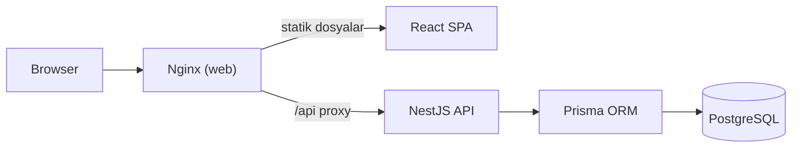
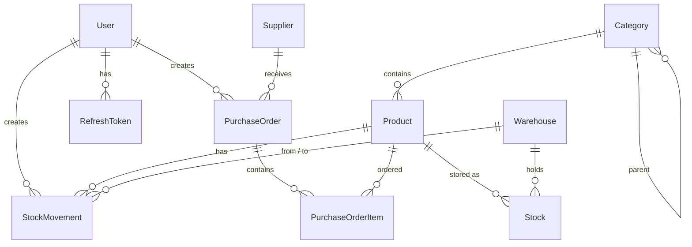

# Stokify

Çok depolu işletmeler için stok takip ve depo yönetim sistemi. NestJS + Prisma + PostgreSQL backend, React + TypeScript frontend; tek komutla Docker üzerinde ayağa kalkar ve **veritabanı boşsa gerçekçi demo verileriyle otomatik olarak dolar**.

## Özellikler

- **Ürün yönetimi**: SKU/barkod, hiyerarşik kategori, alış/satış fiyatı, minimum stok seviyesi, soft delete
- **Depo bazlı stok**: Her ürünün her depodaki miktarı ayrı tutulur
- **Stok hareketleri**: Giriş, çıkış, depolar arası transfer ve sayım düzeltmesi; tamamı transaction içinde ve hareket geçmişiyle birlikte
- **Satın alma siparişleri**: Taslak → Sipariş Verildi → Teslim Alındı akışı; teslim alımda otomatik stok girişi
- **Dashboard**: Stok değeri, kritik/tükenen ürünler, günlük giriş-çıkış grafiği, kategori dağılımı, en çok çıkış yapılan ürünler
- **Rol tabanlı yetkilendirme**: Admin, Depo Müdürü, Depo Personeli
- **Denetim kaydı (audit log)**: Her değişiklik önce/sonra değerleriyle kaydedilir
- **CSV dışa aktarma**: Türkçe Excel uyumlu (UTF-8 BOM, `;` ayraç)
- Açık/koyu tema, responsive arayüz

## Hızlı Başlangıç

Gereksinim: Docker Desktop

```bash
cp .env.example .env
docker compose up -d --build
```

| Servis                 | Adres                          |
| ---------------------- | ------------------------------ |
| Web arayüzü            | http://localhost:8080          |
| API                    | http://localhost:3000/api/v1   |
| Swagger dokümantasyonu | http://localhost:3000/api/docs |

İlk açılışta migration'lar uygulanır ve veritabanı boş olduğu için demo verileri yüklenir.

### Demo hesaplar

| Rol            | E-posta             | Şifre       |
| -------------- | ------------------- | ----------- |
| Admin          | admin@stokify.com   | Admin123!   |
| Depo Müdürü    | manager@stokify.com | Manager123! |
| Depo Personeli | staff@stokify.com   | Staff123!   |

Giriş ekranındaki "Demo hesaplar" butonları bilgileri otomatik doldurur.

### Demo verisi

- 5 kullanıcı, 3 depo (İstanbul, Ankara, İzmir), 14 kategori (iki seviyeli), 15 tedarikçi
- ~120 ürün ve son 90 güne yayılmış ~1500 stok hareketi
- 25 satın alma siparişi (farklı durumlarda)
- Dashboard uyarılarının dolu görünmesi için bilinçli olarak kritik seviyenin altında ve tükenmiş ürünler

Veri üretimi deterministiktir (`faker.seed(42)`), her kurulumda aynı veri oluşur. Hareketler kronolojik olarak simüle edildiği için `stocks` tablosundaki miktarlar hareket geçmişiyle birebir tutarlıdır.

## Yerel Geliştirme

Gereksinim: Node.js 20+, Docker (yalnızca PostgreSQL için)

```bash
npm install
cp .env.example .env
cp apps/api/.env.example apps/api/.env
npm run db:up        # PostgreSQL container'ı
npm run db:migrate   # migration'ları uygula
npm run dev          # API (3000) + Web (5173) birlikte
```

Web arayüzü: http://localhost:5173 (Vite, `/api` isteklerini 3000 portuna proxy'ler)

| Komut              | Açıklama                                                          |
| ------------------ | ----------------------------------------------------------------- |
| `npm run dev`      | API ve web'i watch modunda başlatır                               |
| `npm run db:seed`  | DB boşsa demo verilerini yükler                                   |
| `npm run db:reset` | DB'yi sıfırlar ve demo verilerini yeniden yükler                  |
| `npm test`         | API (Jest) ve web (Vitest) unit testleri                          |
| `npm run test:e2e` | Gerçek PostgreSQL'e karşı API e2e testleri (`stokify_test` DB'si) |
| `npm run lint`     | ESLint                                                            |
| `npm run build`    | Production build                                                  |

## Mimari



```
apps/
├── api/                    NestJS REST API
│   ├── prisma/             Şema, migration'lar, seed giriş noktası
│   ├── src/
│   │   ├── common/         Decorator'lar, exception filter, sayfalama DTO'ları
│   │   ├── config/         Joi ile ortam değişkeni doğrulaması
│   │   ├── database/       PrismaService, otomatik seed (SeedService + seeder)
│   │   └── modules/        auth, users, products, categories, suppliers,
│   │                       warehouses, stock, purchase-orders, reports, audit, health
│   └── test/               E2E testleri
└── web/                    React + Vite SPA
    └── src/
        ├── components/     ui (shadcn tarzı), layout, ortak bileşenler
        ├── features/auth/  AuthContext, login, korumalı route
        ├── lib/            Axios istemcisi (otomatik token yenileme), query hook'ları
        └── pages/          Sayfalar (lazy-loaded)
```

### Veritabanı şeması



## Teknik Kararlar

**Stok tutarlılığı ve eşzamanlılık.** Stok çıkışı tek bir koşullu atomik sorguyla yapılır:
`UPDATE stocks SET quantity = quantity - n WHERE ... AND quantity >= n`. Güncellenen satır yoksa işlem "yetersiz stok" hatasıyla geri alınır. Bu sayede aynı anda gelen çıkış istekleri ek kilit gerektirmeden stoğu negatife düşüremez; ayrıca veritabanında `CHECK (quantity >= 0)` kısıtı son savunma hattıdır. E2E testinde 10 birimlik stoğa 15 eşzamanlı çıkış isteği gönderilir ve tam 10 tanesinin başarılı olduğu doğrulanır.

**Sayım düzeltmesi** satırı `SELECT ... FOR UPDATE` ile kilitler, sayılan ile sistemdeki arasındaki işaretli farkı hareket olarak kaydeder.

**Satın alma durum makinesi.** Geçerli geçişler tek yerde tanımlıdır. Durum güncellemesi `WHERE status = <mevcut durum>` koşuluyla yapılır, böylece bir sipariş iki kez eşzamanlı teslim alınamaz (stok iki kez artmaz).

**Hareket kaydı + stok tablosu.** Her işlem aynı transaction içinde hem `stocks` (anlık durum, hızlı okuma) hem `stock_movements` (değişmez geçmiş) tablosuna yazar.

**Kimlik doğrulama.** Kısa ömürlü JWT access token (15 dk) + veritabanında HMAC hash'i saklanan opak refresh token. Refresh token rotation uygulanır: her kullanımda eski token iptal edilir; iptal edilmiş bir token tekrar kullanılırsa (çalınma şüphesi) kullanıcının tüm oturumları kapatılır. Login'de kullanıcı bulunamasa da bcrypt karşılaştırması yapılır (timing attack koruması). Frontend'de eşzamanlı 401'ler tek bir refresh isteğiyle karşılanır.

**Audit log.** `@Auditable('Product')` decorator'ı olan controller'lardaki tüm mutasyonlar bir interceptor tarafından, işlem öncesi kayıt veritabanından okunarak önce/sonra farkıyla kaydedilir. Hassas alanlar (şifre hash'i, token) otomatik ayıklanır.

**Soft delete.** Ürünler hareket geçmişine bağlı olduğu için silinmez, `deletedAt` ile işaretlenir. Kullanıcılar pasifleştirilir ve oturumları kapatılır.

**Diğer.** Global validation pipe (whitelist + forbidNonWhitelisted), standart hata formatı (Prisma hataları anlamlı HTTP kodlarına çevrilir), request-id ile yapılandırılmış loglama (Pino), Helmet, rate limiting (login için daha sıkı), Joi ile env doğrulaması, `/health` endpoint'i, URI versiyonlama (`/api/v1`), CSV injection koruması.

## API

Tüm endpoint'ler Swagger'da (`/api/docs`) belgelenmiştir. Özet:

| Endpoint                                                    | Açıklama                                                       | Yetki                      |
| ----------------------------------------------------------- | -------------------------------------------------------------- | -------------------------- |
| `POST /auth/login`, `/auth/refresh`, `/auth/logout`         | Oturum yönetimi                                                | Herkes                     |
| `GET /products`, `/products/:id`                            | Arama, kategori/depo/stok durumu filtresi, sıralama, sayfalama | Tümü                       |
| `POST/PATCH/DELETE /products`                               | Ürün yönetimi                                                  | Müdür+                     |
| `POST /stock/in`, `/stock/out`, `/stock/transfer`           | Stok hareketleri                                               | Tümü                       |
| `POST /stock/adjust`                                        | Sayım düzeltmesi                                               | Müdür+                     |
| `GET /stock/movements`                                      | Hareket geçmişi (tarih/tür/depo/ürün filtresi)                 | Tümü                       |
| `POST /purchase-orders/:id/order`, `/receive`, `/cancel`    | Sipariş akışı                                                  | Müdür+ (teslim alma: tümü) |
| `GET /reports/dashboard`, `/reports/critical-stock`         | Raporlar                                                       | Tümü                       |
| `GET /reports/export/products`, `/reports/export/movements` | CSV                                                            | Müdür+                     |
| `GET /audit-logs`, `/users`                                 | Yönetim                                                        | Admin                      |
| `GET /health`                                               | Sağlık kontrolü                                                | Herkes                     |

## Testler

- **API unit (Jest)**: Stok servis iş kuralları, satın alma durum geçişleri, refresh token rotation ve yeniden kullanım tespiti, rol guard'ı, CSV üretimi
- **API e2e (Jest + Supertest)**: Ayrı bir test veritabanına karşı; otomatik seed, yetkilendirme, doğrulama hata formatı, stok akışı, eşzamanlı çıkış, satın alma akışı ve audit kaydı
- **Web (Vitest + Testing Library)**: Login formu doğrulaması ve oturum açma akışı, yardımcı fonksiyonlar

## CI

GitHub Actions her push/PR'da PostgreSQL service container ile lint, typecheck, unit test, e2e test ve build adımlarını çalıştırır; ardından Docker imajlarını derler.

## Kalite Araçları

ESLint, Prettier, Husky + lint-staged (commit öncesi format), Conventional Commits kontrolü (`feat(stock): ...`).
